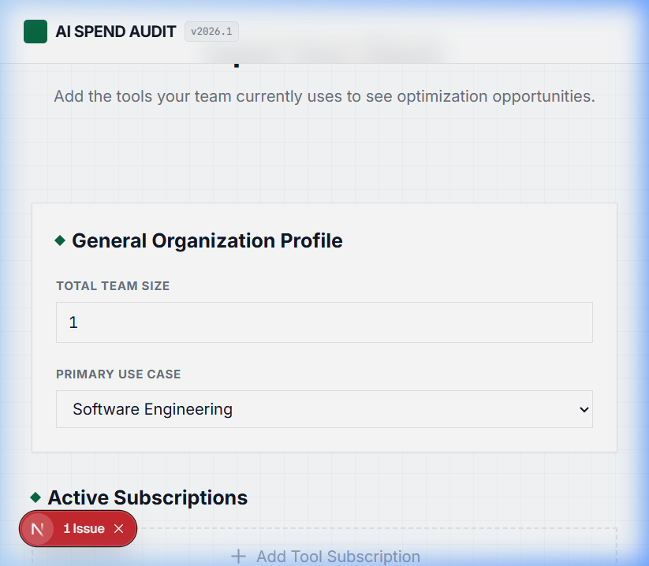
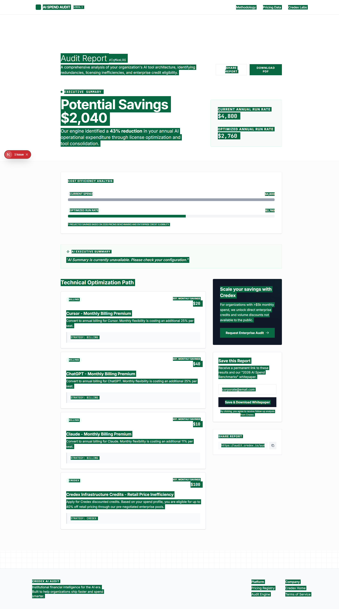
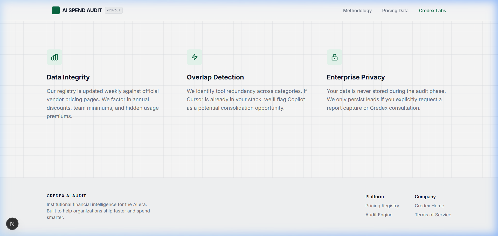

# AI Spend Audit

Teams pick up AI subscriptions one at a time, an IDE assistant here and a few chat seats there, and rarely check whether the tools overlap or the plans still fit. This free web app takes a team's AI stack (tools, plans, seats and monthly spend) and returns an audit: overlapping tools, plans that don't fit the team size, monthly billing that could be annual, and the total potential savings. Each audit gets a shareable link.

**Who it's for:** engineering managers and technical co-founders at 5–200 person startups paying for tools like Cursor, GitHub Copilot, Claude, ChatGPT, Gemini, or the Anthropic and OpenAI APIs.

Built to a brief from Credex (credex.rocks), May 2026. The results page ends with a lead-capture step for Credex's discounted AI credits.

- **Live app:** [credex-ai-spent-audit.vercel.app](https://credex-ai-spent-audit.vercel.app)
- **Case study:** [aryanpanwar.in/case-studies/credex-spend-audit](https://aryanpanwar.in/case-studies/credex-spend-audit)

## Screenshots

**Landing page and audit form**


**Audit results with savings breakdown**


**How the audit works (landing page)**


## How it works

1. **Input form.** Users add each tool with its plan, seats and monthly spend, plus team size and main use case. The price list in `src/lib/pricing.ts` covers Cursor, GitHub Copilot, Windsurf, ChatGPT, Claude, Gemini, the Anthropic API, the OpenAI API and Perplexity. Form state is saved in `localStorage`, so a reload doesn't lose it.
2. **Audit engine.** `src/lib/audit-engine.ts` is a set of plain TypeScript rules, with no LLM involved:
   - More than one AI coding tool (Cursor, Copilot, Windsurf): flag all but the most expensive as overlap.
   - A monthly plan that has a cheaper annual version: show the annual-billing saving.
   - A chat tool on a Team plan with fewer than 2 seats: suggest a downgrade.
   - 5 or more seats on individual Plus/Pro plans: suggest a Team plan if it costs less.
   - If those savings come to more than $500 a year: add a Credex credits line, estimated at 25% of current monthly spend.

   Each recommendation comes with a one-sentence reason.
3. **Results page.** Total potential annual savings and the percentage reduction, current vs optimised annual run rate, and a card per recommendation showing the tool, the issue, the suggested action and the estimated monthly saving.
4. **AI summary.** The Cerebras Cloud SDK (`llama3.1-8b`) writes a short summary paragraph from the audit numbers. If the API key is missing or the call fails, a fixed fallback message is shown instead. The model never touches the savings math.
5. **Lead capture.** An email form on the results page saves the address to a Supabase `leads` table and sends a confirmation email through Resend.
6. **Shareable link.** Each audit is saved under a short random ID (nanoid) at `/audit/[id]`. The audit record holds the tool inputs, results and summary. Email addresses are kept in the separate `leads` table.

## Design decisions

### 1. Rules for the math, LLM only for the wording
**Decision:** savings come from hard-coded TypeScript rules, not an LLM.
**Why:** a finance lead reading the report needs to be able to check every number, and an LLM can invent a saving that doesn't exist. Each rule-based figure traces back to the user's inputs and the price list in `pricing.ts`, with sources in `PRICING_DATA.md`. The one exception is the Credex credits line, which is a flat 25% estimate. The LLM only writes the summary paragraph.
**Trade-off:** prices have to be updated by hand when vendors change them. Being checkable matters more here than automation.

### 2. Manual entry instead of billing integrations
**Decision:** users type in their spend. No OAuth, no "connect your billing" flow.
**Why:** asking a CTO to grant billing access to an unfamiliar tool is a non-starter for security-conscious teams. Manual entry adds friction, but anyone willing to spend three minutes on it is a high-intent lead.
**Trade-off:** no real usage data (API call volumes, seat utilisation) to make the rules smarter. If manual-entry leads converted below 5%, I would revisit a browser-extension approach.

### 3. Custom styling instead of a component library
**Decision:** custom CSS tokens and components instead of shadcn/ui or MUI defaults.
**Why:** the results page is what people screenshot and share, and a stock card layout looks like every other SaaS dashboard. A 24px grid, emerald-800 accents and JetBrains Mono for figures make it read like an audit report.
**Trade-off:** about 4 extra hours of CSS work.

### 4. Shareable links as the growth loop
**Decision:** every audit gets a persistent `/audit/[id]` URL that shows the results but not the user's email.
**Why:** the brief calls this "the viral loop — design accordingly." A founder drops the link in Slack or a CFO forwards it to the board, and each view is a new visitor who sees what the tool does before reading any copy.
**Trade-off:** it needs a database instead of a stateless, URL-encoded result. Worth it, since the link is how the tool spreads.

### 5. Monospace for money
**Decision:** all monetary figures use JetBrains Mono, while body text uses Inter.
**Why:** columns of numbers are easier to scan in monospace, and it reads like a statement rather than a blog post, which suits finance-minded readers.
**Trade-off:** two type styles on one page. Intentional.

## Tech stack

| Layer | Choice | Why |
|---|---|---|
| Framework | Next.js 16 (App Router) | Pages and API routes in one repo, plus built-in metadata for social previews |
| Language | TypeScript | Type safety for money calculations |
| Styling | Tailwind CSS v4 + custom CSS tokens | A custom look instead of a stock UI kit |
| Animation | Framer Motion | Small transitions on the form and results |
| Database | Supabase (Postgres) | Free tier and a ready-made API |
| Email | Resend | Simple API, free tier |
| AI | Cerebras Cloud SDK (`llama3.1-8b`) | Summary paragraph, with a fallback if the call fails |
| Testing | Vitest | Fast unit tests for the audit engine |
| CI | GitHub Actions | Lint, test and build on every push and PR to `main` |
| Deploy | Vercel | Zero-config Next.js hosting |

## Security and abuse protection
- A hidden honeypot field on both forms. If a bot fills it in, the browser drops the submission. There is no server-side check yet.
- Server-side rate limiting is not implemented yet.
- No secrets in the repo. All keys come from environment variables.

## Results and testing
- Live at [credex-ai-spent-audit.vercel.app](https://credex-ai-spent-audit.vercel.app).
- 5 Vitest unit tests on the audit engine cover IDE overlap, annual billing for Cursor Pro, a Team plan for large groups on individual Claude accounts, the annual savings calculation, and Credex eligibility for high spend.
- GitHub Actions runs lint, tests and a production build on every push and pull request to `main` (see [`.github/workflows/ci.yml`](.github/workflows/ci.yml)).

## How to run

### Prerequisites
- Node.js 18+ (CI uses Node 20)
- A Supabase project (free tier)
- A Cerebras API key ([cloud.cerebras.ai](https://cloud.cerebras.ai))
- A Resend API key

### 1. Clone and install
```bash
git clone https://github.com/Aryanpanwar10005/credex_AI_spent_audit.git
cd credex_AI_spent_audit
npm install
```

### 2. Environment variables
Create `.env.local` in the project root:
```env
NEXT_PUBLIC_SUPABASE_URL=your_supabase_project_url
NEXT_PUBLIC_SUPABASE_ANON_KEY=your_supabase_anon_key
CEREBRAS_API_KEY=your_cerebras_api_key
RESEND_API_KEY=your_resend_api_key
NEXT_PUBLIC_APP_BASE_URL=http://localhost:3000
```

### 3. Database
The SQL schema is not committed (it lives in a git-ignored `internal/` folder). From the code, the app expects two tables:
- `audits`: `id`, `public_id`, `input_data`, `result_data`, `ai_summary`
- `leads`: `email`, `audit_id`

### 4. Run locally
```bash
npm run dev
# App at http://localhost:3000
```

### 5. Run tests
```bash
npm test
# 5 Vitest unit tests on the audit engine
```

### 6. Deploy to Vercel
```bash
npx vercel --prod
# Add the same environment variables under Project Settings → Environment Variables
```

## Project structure

```
├── src/
│   ├── app/
│   │   ├── page.tsx              # Landing page and audit form
│   │   ├── audit/[id]/page.tsx   # Public, shareable results page
│   │   └── api/
│   │       ├── audit/route.ts    # Runs the audit, saves it, returns the public ID
│   │       └── leads/route.ts    # Saves the email and sends the confirmation
│   ├── components/
│   │   ├── AuditForm.tsx         # Multi-tool form, saved to localStorage
│   │   └── LeadForm.tsx          # Email capture with honeypot field
│   └── lib/
│       ├── audit-engine.ts       # Audit rules
│       ├── pricing.ts            # Price list (checked against vendor pages, May 2026)
│       ├── ai-summary.ts         # Cerebras call and fallback
│       ├── email.ts              # Resend confirmation email
│       ├── supabase.ts           # Supabase client
│       └── __tests__/            # Vitest unit tests
├── .github/workflows/ci.yml      # Lint, test, build
├── ARCHITECTURE.md, TESTS.md, PRICING_DATA.md, PROMPTS.md   # Engineering notes
├── GTM.md, ECONOMICS.md, METRICS.md, LANDING_COPY.md        # Go-to-market and pricing notes
├── USER_INTERVIEWS.md, DEVLOG.md, REFLECTION.md             # Research, build log, retrospective
└── README.md
```

---

Built by [Aryan Panwar](https://aryanpanwar.in). Case study: [aryanpanwar.in/case-studies/credex-spend-audit](https://aryanpanwar.in/case-studies/credex-spend-audit).
